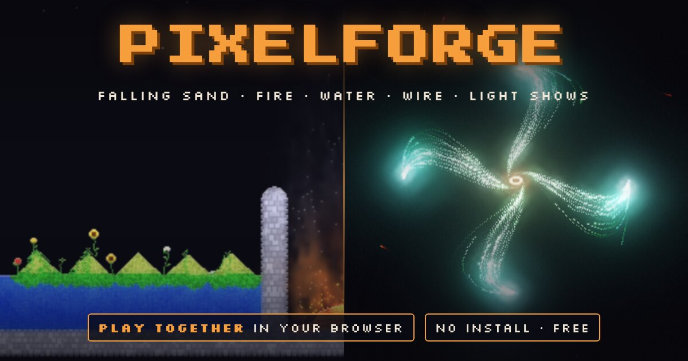
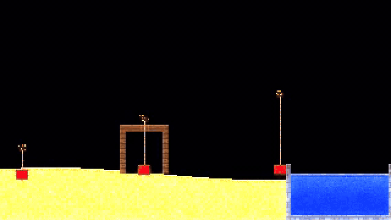
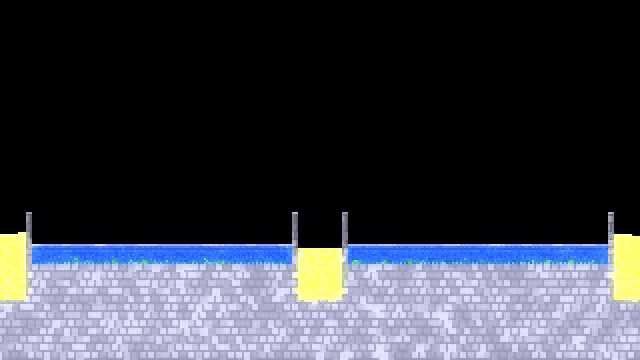
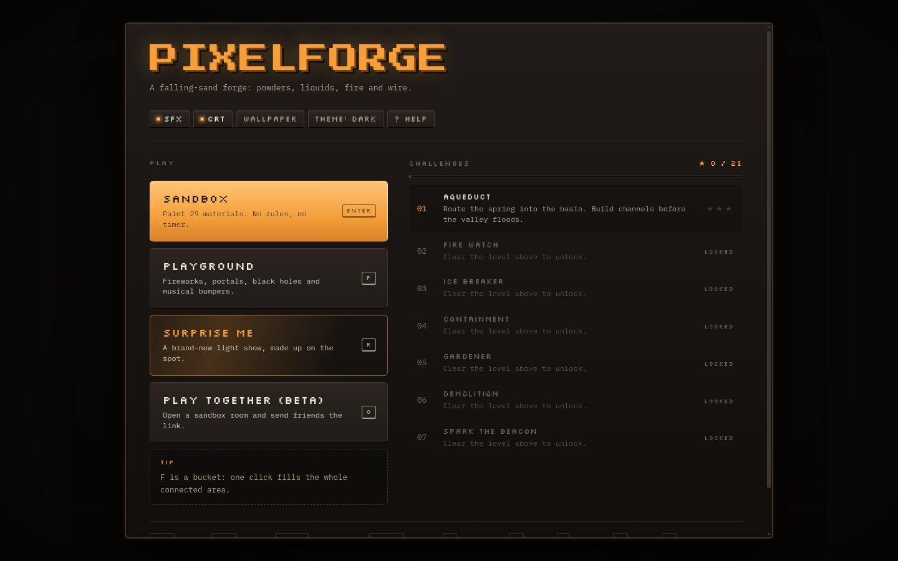
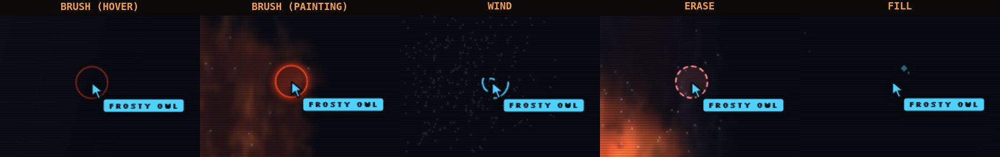
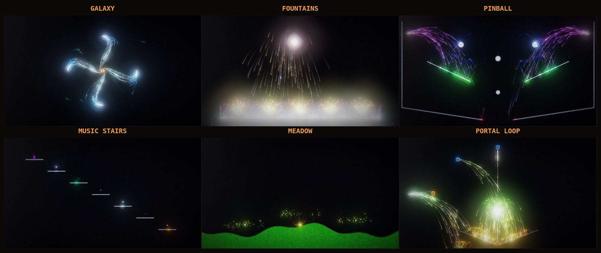
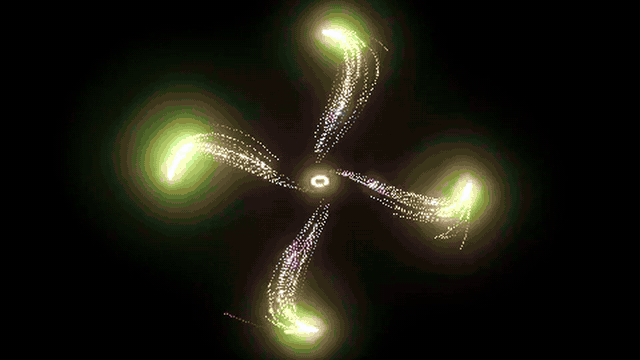

# PIXELFORGE

A pixel-art falling-sand forge for the browser. Paint 29 materials that burn,
flow, grow and explode; build with friends in the same world over a link; make
light shows with fireworks, portals, black holes and musical bumpers; pick
elements off a periodic table and watch them react in the chem lab; or solve
7 goal-based challenges. Everything is simulated in a Web Worker at a fixed
60 Hz on a 640x360 grid and rendered with WebGL.

No game assets, no UI framework: TypeScript + Vite + WebGL + WebAudio,
everything procedural. three.js and Trystero load only when the 3D views or
multiplayer are used.

**▶ Play it: https://cloverag.github.io/pixelforge/**




| TNT on fuses | Flowers growing |
|:---:|:---:|
|  |  |



---

## Run it

```bash
npm install
npm run dev       # dev server (Vite default http://localhost:5173)
```

Other scripts:

```bash
npm run build     # typecheck (tsc --noEmit) + production bundle to dist/
npm run preview   # serve the production build locally
npm run test      # vitest suite
npm run typecheck # tsc --noEmit only
```

Works in any modern browser with WebAudio and Web Workers; WebGL for the
glow, fluid and 3D views (a 2D fallback draws the plain simulation). Phones
get their own layout.

## Game modes

| Mode | What it is |
|------|------------|
| **SANDBOX** | Paint any material with the brush, flood-fill (`F`) or blow wind (`W`); right-drag erases. Your world autosaves and comes back on reload; SAVE / LOAD / SHARE a link to it. |
| **PLAY TOGETHER (beta)** | A room for friends: open one, send the link, and everyone builds in the same world - the sandbox or the playground. See [Playing together](#playing-together). |
| **PARTICLE PLAYGROUND** | Light shows instead of materials: emitters, forces, bumpers that play notes, portals - with a film-look renderer, a full 3D view and sound design. See [The playground](#the-playground). |
| **CHEM LAB** | Pick elements off a periodic table and drop them into water, acid, fire or each other: 30 elements, 70 reactions, 3 ready-made experiments. See [The chem lab](#the-chem-lab). |
| **SURPRISE ME** | A brand-new generated playground scene every click (`R`). |
| **CHALLENGES** | 7 goal-based puzzles with material budgets, time limits, win/lose checks and a 3-star rating. Levels unlock in order; stars persist in `localStorage`. |

### Challenges

| # | Name | Goal |
|---|------|------|
| 1 | AQUEDUCT | Route the spring into the basin before the valley floods. |
| 2 | FIRE WATCH | Extinguish the grove fire before the wooden village burns down. |
| 3 | ICE BREAKER | Melt the glacier wall with a limited lava ration. |
| 4 | CONTAINMENT | Patch the reservoir crack before lava reaches the reactor. |
| 5 | GARDENER | Sow seeds and water them into a living meadow. |
| 6 | DEMOLITION | Breach the tower with limited gunpowder and fuse. |
| 7 | SPARK THE BEACON | Bridge the broken wire so sparks reach the beacon tower. |

Each challenge shows only its allowed materials; budgeted swatches show a
remaining-count badge and grey out when exhausted.

## Playing together

**PLAY TOGETHER** on the menu (or `O`) asks your name and colour, opens a room
from your current sandbox and copies its link. Anyone who opens the link joins
your world. Pasted into WhatsApp or Discord, the link shows a preview card.

- **Live cursors.** Everyone's pointer shows in their colour with their name,
  and a mark for the tool they hold: a brush-sized ring in their material's
  colour, a dashed ring for erase, swirling arcs for wind, a bucket for fill -
  faint while hovering, solid while painting.
- **Who is here.** The room badge shows everyone as coloured initials with
  their ping. Click your own dot to rename yourself.
- **Reactions.** A bar along the bottom of the canvas: 👍 🔥 😂 😮 ❤️ pop up as
  a bubble on your cursor and on your avatar; **PING** (or `Z`) marks a spot
  with pulsing rings, "NAME: LOOK HERE".
- **Sandbox, playground or chem lab.** The host's `→ PLAYGROUND` /
  `→ CHEM LAB` / `→ SANDBOX` button takes the whole room to the next one;
  fireworks, portals, scenes, reactions and experiments are shared like
  everything else.
- **Leaving** asks first. A host who refreshes reopens the same room from the
  autosave and guests re-sync on their own; a host who leaves closes it.



### How it works

There is no game server. [Trystero](https://github.com/dmotz/trystero) finds
peers through public Nostr relays and connects browsers directly over WebRTC.

The sandbox simulation is deterministic for a seed and an input sequence, so
peers send **inputs, not pixels** (`src/net/lockstep.ts`):

- The **host sequences** everyone's actions: it stamps each batch three frames
  ahead and broadcasts one frame message per step. Guests step exactly the
  frames they hold, catching up many at once after a hidden tab.
- A **joiner** gets a gzipped snapshot of the complete state - cells, meta,
  per-frame clock, chunk wake bitmap, wind field, TNT debris in flight, RNG
  position - plus every
  frame since (`src/net/pack.ts`; ~1 KB for an empty world).
- Every 60 frames peers compare a **fingerprint** of the world, by component.
  A guest that disagrees asks for a fresh copy and carries on (**self-repair**),
  which also covers browsers whose float maths differ.
- Cursors and reactions travel peer to peer on their own channels and never
  touch the shared world.
- In the **playground** every action is a frame-stamped input too, and joiners
  get every particle, so on one browser engine the whole show is identical.
  The fingerprint covers what was built (walls, bumpers, forces, portals,
  emitters, gravity, speed) but not the particles: they run on float maths
  that can differ in the last bit between engines, and a particle system
  amplifies that within seconds. Particles step with the world, never inside
  the draw, so a peer catching up stays in step.

Finding the last desync took an offline replay: two snapshots identical in
every field still split, and the cause was the RNG state growing past 2^53 and
rounding. It is wrapped to 32 bits now, with every sequence unchanged.

## The playground





| Group | Tools |
|-------|-------|
| **Emitters** | FOUNTAIN, FIREWORK (a rocket that bursts where you click, as a peony, ring, gold willow, crossette or palm), SPARKLER, HOSE (sprays the way you drag), FIREFLIES |
| **Forces** | ATTRACT, REPULSE, VORTEX, BLACK HOLE (spirals matter in and swallows it; swallow a firework whole and it flares - a shockwave and twin jets) |
| **Tools** | WALL, BUMPER (a bouncy wall that plays a note set by its height), PORTAL (click twice for a linked pair), ERASE |
| **Scenes** | GALAXY, FOUNTAINS, PINBALL, MUSIC STAIRS, MEADOW, PORTAL LOOP - self-running demos - and SURPRISE ME |
| **Actions** | GRAVITY (`G`), SLOW-MO (`Q`), CLEAR (`X`) |

- **A living sky:** a dim nebula and stars in three depths that drift and
  twinkle, with the odd shooting star, so the playground is never a black
  void. Forces bend it: a black hole casts a dark shadow ringed by lensed
  stars, and vortices stir the nebula into spiral arms.
- **Film look:** particles are light - HDR bloom over five mips, ACES filmic
  tone mapping, faint lens fringing and grain; walls are lit by what glows near
  them.
- **3D view** (`3`): the same simulation as a lit three.js scene - emissive
  particles, a reflective floor, fireworks that light the room, orbit with
  right-drag.
- **Sound design** that follows the simulation: water hiss, force hum,
  black-hole rumble, marimba bumper notes (C pentatonic, so any mix is in tune),
  rocket whistles and crackle, chimes from fireflies, and an ambient pad that
  swells with the particle count. Silent while the tab is hidden.
- **SURPRISE ME** builds a scene from a seed in one of four styles - orbit,
  cascade, festival, storm - with a generated name like NEON WHIRLPOOL. 200
  seeds are checked headless so none comes out empty.

## The chem lab

The chem lab is the sandbox's world painted with elements instead of
materials. Its left rail holds the 30 elements it simulates, grouped as gases,
metals, non-metals and liquids, plus a bench of water, acid, lye, rust, fire, a torch,
lava, plants, glass and wall.

- **Periodic table** (`E`): all 118 elements in their usual places, coloured
  by family. The lab's 30 are lit and clickable; the rest are dim. Hovering
  one shows its family, state, mass, melting and boiling points, and every
  reaction it takes part in here.
- **Reactions are a table** (`src/sim/reactions.ts`): when two cells touch, a
  rule says what each becomes, the chance per tick, and an optional condition
  (heat, or a helper such as water) and effect. Some of the 70:

| Pair | What happens |
|------|--------------|
| lithium / sodium / potassium + water | fizz into hydrogen and lye, faster down the group; potassium bursts into lilac flame |
| hydrogen + oxygen, near heat | explode into steam, and the blast carries through the cloud |
| hydrogen + chlorine, near heat | explode into acid |
| caesium + water | explodes into hydrogen and lye: the alkali finale |
| fluorine + hydrogen, water, glass, sodium, wood | needs no heat: it explodes, splits water, etches glass, burns sodium and sets wood alight |
| mercury + sulfur | cinnabar: the spill clean-up trick; mercury also eats aluminium |
| sodium + chlorine | burn into table salt |
| aluminium + rust, near heat | thermite: both melt into molten iron |
| magnesium + fire | burns with a blinding white flame |
| metals + fire, or over a torch | flame tests: sodium yellow, potassium lilac, lithium and strontium crimson, copper blue-green, barium apple green, calcium orange |
| lye + acid | neutralise into salt water |
| iron + oxygen or water | rusts, slowly |
| neon + torch | glows red-orange, and passes the glow along |
| iodine + fire or lava | turns straight to violet vapour, which settles back as crystals |

- **Experiments**: ALKALI BATH, THERMITE (a magnesium ribbon burns into a
  crucible that melts down and through its floor) and FLAME TESTS.
- Real densities keep their order: sodium, potassium and lithium float on
  water, iron and copper sink, and mercury and gold sink under everything else.
- **Element data** comes from [PubChem](https://pubchem.ncbi.nlm.nih.gov/periodic-table/)
  (NCBI), fetched once by `scripts/fetch-elements.mjs` into
  `src/data/elements.json` and shipped with the game; no player's browser
  calls PubChem. The reactions are hand-written: no machine-readable dataset
  of element-pair reactions exists. The periodic table loads on first open,
  so its data (5 kB gzip) is not in the entry bundle.

## Controls

| Input | Action |
|-------|--------|
| Left drag | Paint selected material / use playground tool |
| Right drag | Erase |
| Mouse wheel, `[` `]` | Brush size (2-24) |
| `F` | Flood-fill bucket (sandbox) |
| `W` | Wind brush: drag to blow, click for a puff (sandbox) |
| `1`-`9` | Quick-select palette swatch (sandbox) |
| `SPACE` / `N` | Pause / single step while paused |
| `G` / `Q` / `X` | Gravity / slow-mo / clear (playground) |
| `R` | SURPRISE ME (menu and playground) |
| `L` | Chem lab (menu) |
| `E` | Periodic table (chem lab) |
| `O` | Open a room (menu) |
| `Z` | Ping where your cursor is (in a room) |
| `3` | 3D view |
| `I` | Immersive: the canvas fills the window; push the pointer to an edge for the panels |
| `B` | Grid view: chunky blocks, cycles 4 / 8 / 16 px then off |
| `S` / `C` | Soft glow / CRT filter |
| `M` | Mute everything (a toast says SOUND ON / OFF) |
| `D` | FPS readout in the canvas corner (off by default) |
| `ESC` | Close the periodic table, leave immersive mode, then the **pause menu** (alone it freezes the game; in a room it does not). QUIT TO TITLE asks first in a room |

On a phone the top bar folds into one row with a **MORE** menu, the canvas
goes full width and the materials become large buttons below it (beside it
in landscape).

## Interface

The UI is one CSS file and a handful of DOM builders - no component framework,
no icon set, no images.

- **One look, always dark.** The game uses the title screen's palette: every
  panel, button and the canvas wears the same pixel frame (a 2px border and a
  hard 4px shadow), with no gradients, bevels or glows. Toggles show state by
  fill (accent = on). Fire and glow are additive light, which vanishes on a
  light field, so there is no light theme.
- Explosions shake the canvas, flash and boom.
- The rail is **tiles**: a 56px square painted from each material's **real
  colour ramp**, its name under it, three to a row, grouped by kind (powder /
  life / liquid / gas / solid), so the rail doubles as a legend. The picked tile
  has an accent outline and a marker. The brush is five dots of growing size
  (the wheel and `[` `]` move the lit one); BUCKET and WIND are tiles beside
  ERASE. Solids are textured: bricks, wood grain,
  cobbles, glass glints, ice fractures.
- **SOFT** blends the simulation with a GPU fluid that carries smoke and glow
  through the wind field; water gets depth, caustics and surface glints.
- Every animation is decorative and switched off under `prefers-reduced-motion`.
  Interactive elements carry focus rings and labels.

Re-theming means editing the tokens in the `:root` block of `styles.css`.

## Materials cheat sheet

Powders fall, liquids flow toward somewhere lower and settle level, gases rise,
solids stay put.

| Material | Behavior |
|----------|----------|
| SAND | Standard powder; turns to mud where it meets water. |
| MUD | Heavy, sticky powder: piles steep and holds a tunnel roof. Heat bakes it back to sand. |
| WATER | Settles level, speeds up as it falls, splashes on landing, carries floating grains, and waterfalls dig into sand. |
| OIL | Lighter than water, flammable, slower to flow. |
| LAVA | Heavy hot liquid that oozes: melts ice, starts fires, cools on water. |
| ACID | Dissolves most things (stone slowly). |
| FIRE | Short-lived gas; ignites flammables (oil, wood, plants, seeds). |
| SMOKE / STEAM | Rise and dissipate. Steam can condense back to water. |
| SEED | Sprouts into a plant on water or mud. |
| PLANT | Grows by drinking water; at the surface it buds into flowers and leaves. |
| ANT | Walks, climbs, digs shafts and galleries in sand and mud, piles the dirt outside. |
| BIRD | Flies at a cruising height, rides the wind, perches on plants, wood and stone. |
| STONE / WALL | Solid; wall is indestructible. |
| ICE | Melts near heat into water. |
| WOOD | Flammable solid. |
| GLASS | Transparent, blast-proof solid. |
| SNOW / SALT | Snow melts near heat; salt melts ice and snow and dissolves in water. |
| GUNPOWDER | Explodes on ignition. |
| FUSE | Slow-burning line for timing charges: fire lights it, the flame creeps along about 9 cells a second and sets off gunpowder or TNT at the end. |
| TNT | Fire or lava lights a short fuse (it blinks); a spark or a burning fuse detonates it at once. Stacks chain. The blast throws its shell and the loose ground around it as debris that arcs and lands back as cells: a crater with a rim, and burning pieces fly as embers. |
| WIRE | Carries spark pulses; glows while energised. |
| TORCH | Sends spark pulses into touching wire. |
| TURBINE | Spins in wind or under falling water, and sparks the wire it touches. |
| CLONE | Copies the first material that touches it, forever. |
| VOID | Deletes neighbouring cells. |
| EMBER | Burning residue left by fires (not placeable). |

## Architecture tour

```
index.html                 app shell, link-preview tags
public/og.jpg              link-preview card
scripts/fetch-elements.mjs regenerates src/data/elements.json from PubChem (by hand)
src/
  main.ts                  fixed-step loop, worker + room wiring, menu; asks the current mode
  styles.css               all styling (the one dark palette, the pixel frame, CRT, phone layout, dialogs)
  data/elements.json       the periodic table: 118 elements, trimmed PubChem data
  modes/
    types.ts               ModeController: what a game screen provides to main.ts
    sand.ts                the sandbox, and each challenge
    playground.ts          the particle playground
    chem.ts                the chem lab
    stroke.ts              brush strokes, shared by every mode
  core/
    input.ts               pointer + keyboard -> simulation coords
    rng.ts                 seeded PRNG (32-bit state)
  sim/
    protocol.ts            message types, Snapshot / NetInput, constants
    grid.ts                typed-array cell store + chunk sleep/wake
    world.ts               the cellular automaton, TNT debris; snapshot / restore / hash
    materials.ts           material table, colour ramps and textures
    wind.ts                coarse wind field over the grid
    particles.ts           playground: emitters, forces, portals, bumpers, rockets
    presets.ts             playground demo scenes
    surprise.ts            SURPRISE ME scene generator
    challenges.ts          declarative challenge definitions
    reactions.ts           the chem lab's reaction table, compiled to a pair lookup
    chemscenes.ts          the chem lab's ready-made experiments
    worker.ts              Web Worker entry: steps and renders off the main thread
  net/
    lockstep.ts            host-sequenced lockstep (HostCore / GuestCore)
    mp.ts                  rooms over Trystero: join, snapshots, repair, presence
    pack.ts                snapshot packing + gzip
    presence.ts            names, colours, cursor and reaction messages
  render/
    glrenderer.ts          WebGL composite: glow, fluid, water, film look
    cinematic.ts           playground HDR bloom + filmic tone mapping
    fluid.ts               GPU stable-fluids smoke/glow
    pg3d.ts                3D playground (three.js, lazy)
    voxel3d.ts             3D sandbox diorama (three.js, lazy)
    renderer.ts, blocks.ts 2D fallback, grid view, canvas fitting
  game/
    audio.ts               procedural SFX and playground sound design
    music.ts               procedural chiptune loop
    juice.ts               screen shake + flash on explosions
    share.ts, rle.ts       share links and save slots
    progress.ts            star progress
    wallpapers.ts          background wallpapers
  ui/
    hud.ts                 top bar, palettes, brush column, status bar
    menu.ts                main menu
    roompill.ts            room badge: roster, rename, copy link, leave
    cursors.ts             remote cursors and reaction bubbles
    emotes.ts              reaction bar and pings
    dialog.ts              in-game confirm and name dialogs
    periodic.ts            the chem lab's periodic table (lazy)
    help.ts, tooltips.ts, cursor.ts, share-panel.ts, widgets.ts
tests/                     vitest: world rules, TNT debris, rendering, playground,
                           scenes, surprise, lockstep, network simulation, RNG,
                           presence, snapshots, chem reactions + experiments,
                           periodic table layout
```

### How a frame flows

1. `main.ts` runs a rAF loop with a 60 Hz accumulator.
2. Each step posts `{t:'step'}` with a transferable buffer to the worker - in a
   room, with the frame's inputs (or several frames' worth, to catch up).
3. The worker applies the inputs, advances the automaton, renders the frame
   into the buffer and sends it back with counts, events (sounds, blasts) and,
   every 60 frames, the world's fingerprint.
4. The renderer composites it on the GPU; the HUD, sound and room update.

### Testing

197 tests. Beyond the material rules: two worlds fed the same inputs must
match for 1200 frames; a world restored mid-game into a different seed must
stay identical; host and two guests over a simulated network with random
delays, reordering and a late joiner must agree at every frame; a corrupted
guest must be repaired; every chem rule must fire on contact and not without
its condition, each experiment must do what its button says, and a world must
not depend on how often its sound events are read. New tests are checked against a broken version of
the code they guard, so a test that cannot fail does not ship.

### Performance budget

Target is **60 FPS at 640x360**. The simulation uses typed arrays and 8x8
chunk sleeping, so a settled world costs almost nothing; the 3D views step
their quality down on slow machines.

## Project workflow

Tasks, claims and review notes live in [TASKS.md](./TASKS.md).

## Deploy

Pushing to `main` runs [`.github/workflows/deploy.yml`](.github/workflows/deploy.yml),
which typechecks, runs the tests, builds, and publishes `dist/` to GitHub Pages.
A failing typecheck or test never ships.

The site is fully static - no server, no API, multiplayer included - so it
needs nothing beyond a file host. `vite.config.ts` sets `base: './'`, and the
worker and wallpapers resolve through `import.meta.url`, so the build works
from any subpath.
