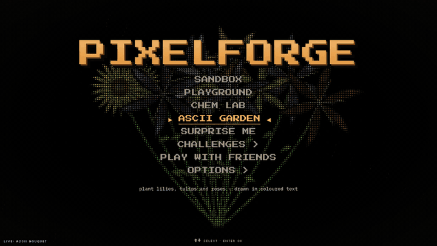
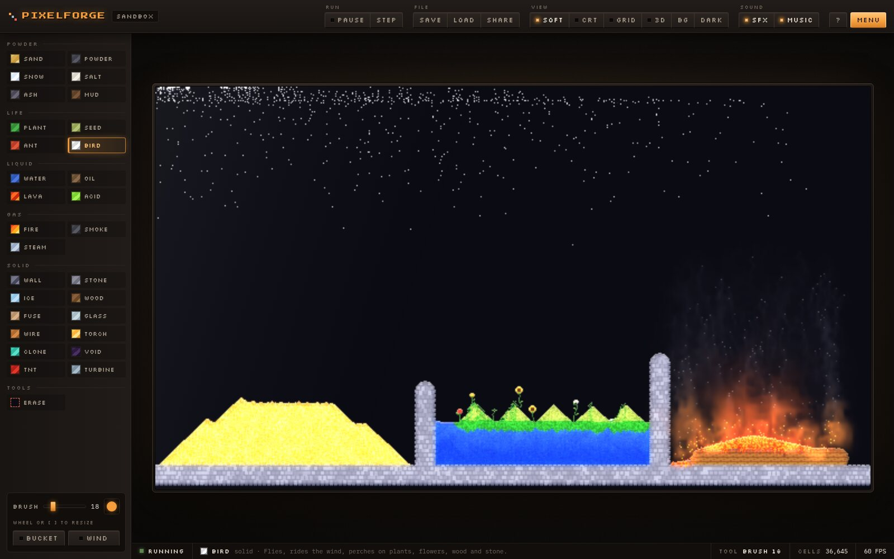
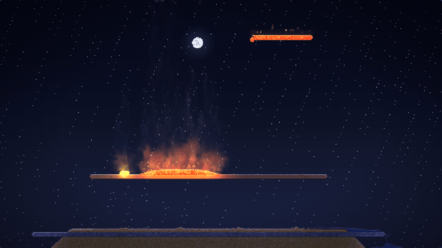
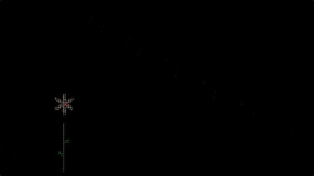
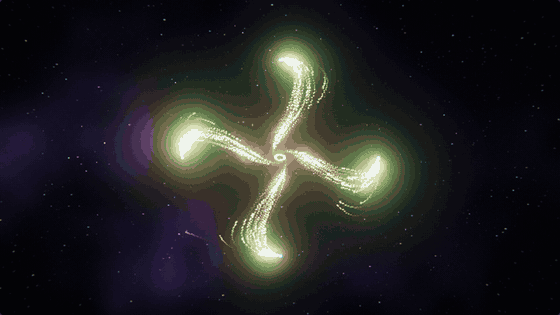
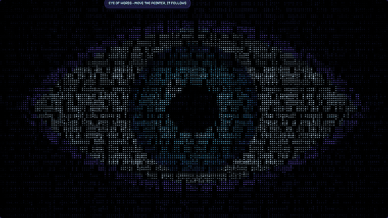
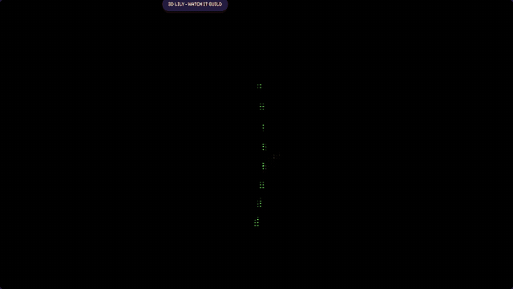
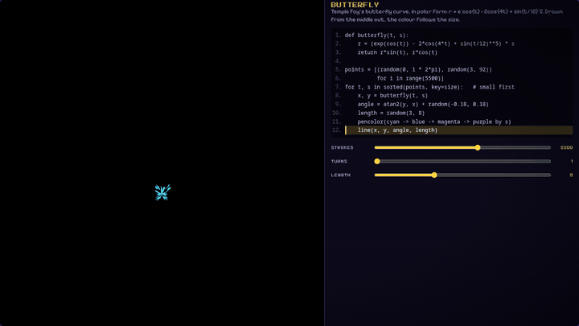
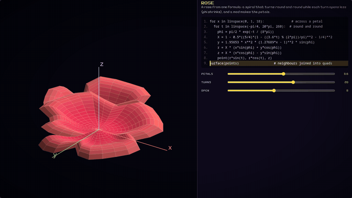

# PIXELFORGE

A pixel-art falling-sand forge for the browser. Paint 29 materials that burn,
flow, grow and explode; build with friends in the same world over a link; make
light shows with fireworks, portals, black holes and musical bumpers; pick
elements off a periodic table and watch them react in the chem lab; turn any
atom in 3D, with its orbitals and the light it gives off; grow a
bouquet of flowers drawn in coloured text in the ASCII garden; or solve 7
goal-based challenges. A sun and a moon cross the sky and cast shadows, and an
optional path tracer bounces firelight around the world. Everything is
simulated in a Web Worker at a fixed 60 Hz on a 640x360 grid and rendered
with WebGL.

No UI framework: TypeScript + Vite + WebGL + WebAudio. The graphics and the
music are procedural; the only assets are 31 CC0 sound effects from Kenney.
three.js and Trystero load only when the 3D views or multiplayer are used.

**▶ Play it: https://cloverag.github.io/pixelforge/**





| Night fire, then the ASCII lamp | The ASCII garden |
|:---:|:---:|
|  |  |

---

## Run it

```bash
npm install
npm run dev       # dev server (Vite default http://localhost:5173)
```

Other scripts:

```bash
npm run build     # typecheck (tsc --noEmit) + production bundle to dist/
npm run preview   # serve the production build locally
npm run test      # vitest suite
npm run typecheck # tsc --noEmit only
```

Works in any modern browser with WebAudio and Web Workers; WebGL for the
glow, fluid and 3D views (a 2D fallback draws the plain simulation). Phones
get their own layout.

## Game modes

| Mode | What it is |
|------|------------|
| **SANDBOX** | Paint any material with the brush, flood-fill (`F`) or blow wind (`W`); right-drag erases. Your world autosaves and comes back on reload; SAVE / LOAD / SHARE a link to it. |
| **PLAY TOGETHER (beta)** | A room for friends: open one, send the link, and everyone builds in the same world - the sandbox or the playground. See [Playing together](#playing-together). |
| **PARTICLE PLAYGROUND** | Light shows instead of materials: emitters, forces, bumpers that play notes, portals - with a film-look renderer, a full 3D view and sound design. See [The playground](#the-playground). |
| **ASCII GARDEN** | Flowers, an eye made of words and 3D lilies, drawn as coloured text. Solo only. See [The ASCII garden](#the-ascii-garden). |
| **MATH LAB** | Watch maths draw itself: a parametric heart, a neon butterfly, a spiral rosette, a globe of ellipses, a recursive tree - and 3D graphs (a rose surface, ripple, saddle, waves) you can turn. The code sits beside the drawing and lights the line drawing now; sliders change its numbers. Solo only. See [The math lab](#the-math-lab). |
| **ELEMENTS** | The periodic table in 3D: pick any of the 118 and its atom turns in front of you - nucleus, electron shells and the shapes of its outer orbitals - beside its numbers, its visible spectrum and what it is used for. Solo only. See [The elements](#the-elements). |
| **CHEM LAB** | Pick elements off a periodic table and drop them into water, acid, fire or each other: 32 elements (uranium and plutonium among them: fission and critical mass), 70 reactions, 5 ready-made experiments. See [The chem lab](#the-chem-lab). |
| **SURPRISE ME** | A brand-new generated playground scene every click (`R`). |
| **CHALLENGES** | 7 goal-based puzzles with material budgets, time limits, win/lose checks and a 3-star rating. Levels unlock in order; stars persist in `localStorage`. |

### Challenges

| # | Name | Goal |
|---|------|------|
| 1 | AQUEDUCT | Route the spring into the basin before the valley floods. |
| 2 | FIRE WATCH | Extinguish the grove fire before the wooden village burns down. |
| 3 | ICE BREAKER | Melt a way through the glacier at ground level with a lava ration - slow drips beat floods. |
| 4 | CONTAINMENT | Patch the reservoir crack before lava reaches the reactor. |
| 5 | GARDENER | Sow seeds and water them into a living meadow. |
| 6 | DEMOLITION | Bring the tower down: a torch, a limited fuse and TNT - stack it up the pillars. |
| 7 | SPARK THE BEACON | Bridge the broken wire so sparks reach the beacon tower. |

Each challenge shows only its allowed materials; budgeted swatches show a
remaining-count badge and grey out when exhausted.

## Playing together

**PLAY TOGETHER** on the menu (or `O`) asks your name and colour, opens a room
from your current sandbox and copies its link. Anyone who opens the link joins
your world. Pasted into WhatsApp or Discord, the link shows a preview card.

- **Live cursors.** Everyone's pointer shows in their colour with their name,
  and a mark for the tool they hold: a brush-sized ring in their material's
  colour, a dashed ring for erase, swirling arcs for wind, a bucket for fill -
  faint while hovering, solid while painting.
- **Who is here.** The room badge shows everyone as coloured initials with
  their ping. Click your own dot to rename yourself.
- **Reactions.** A bar along the bottom of the canvas: 👍 🔥 😂 😮 ❤️ pop up as
  a bubble on your cursor and on your avatar; **PING** (or `Z`) marks a spot
  with pulsing rings, "NAME: LOOK HERE".
- **Sandbox, playground or chem lab.** The host's `→ PLAYGROUND` /
  `→ CHEM LAB` / `→ SANDBOX` button takes the whole room to the next one;
  fireworks, portals, scenes, reactions and experiments are shared like
  everything else.
- **Up to 9 people** a room, the host included: browsers connect to each
  other directly, so a class plays in several small rooms. A tenth gets
  "ROOM … IS FULL" and their own world back.
- **Leaving** asks first. A host who refreshes reopens the same room from the
  autosave and guests re-sync on their own; a host who leaves closes it.

### How it works

There is no game server. [Trystero](https://github.com/dmotz/trystero) finds
peers through public Nostr relays and connects browsers directly over WebRTC.

The sandbox simulation is deterministic for a seed and an input sequence, so
peers send **inputs, not pixels** (`src/net/lockstep.ts`):

- The **host sequences** everyone's actions: it stamps each batch three frames
  ahead and broadcasts one frame message per step. Guests step exactly the
  frames they hold, catching up many at once after a hidden tab.
- A **joiner** gets a gzipped snapshot of the complete state - cells, meta,
  per-frame clock, chunk wake bitmap, wind field, TNT debris in flight, RNG
  position - plus every
  frame since (`src/net/pack.ts`; ~1 KB for an empty world).
- Every 60 frames peers compare a **fingerprint** of the world, by component.
  A guest that disagrees asks for a fresh copy and carries on (**self-repair**),
  which also covers browsers whose float maths differ.
- Cursors and reactions travel peer to peer on their own channels and never
  touch the shared world.
- In the **playground** every action is a frame-stamped input too, and joiners
  get every particle, so on one browser engine the whole show is identical.
  The fingerprint covers what was built (walls, bumpers, forces, portals,
  emitters, gravity, speed) but not the particles: they run on float maths
  that can differ in the last bit between engines, and a particle system
  amplifies that within seconds. Particles step with the world, never inside
  the draw, so a peer catching up stays in step.

Finding the last desync took an offline replay: two snapshots identical in
every field still split, and the cause was the RNG state growing past 2^53 and
rounding. It is wrapped to 32 bits now, with every sequence unchanged.

## The playground



| Group | Tools |
|-------|-------|
| **Emitters** | FOUNTAIN, FIREWORK (a rocket that bursts where you click, as a peony, ring, gold willow, crossette or palm), SPARKLER, HOSE (sprays the way you drag), FIREFLIES |
| **Forces** | ATTRACT, REPULSE, VORTEX, BLACK HOLE (spirals matter in and swallows it; swallow a firework whole and it flares - a shockwave and twin jets) |
| **Tools** | WALL, BUMPER (a bouncy wall that plays a note set by its height), PORTAL (click twice for a linked pair), ERASE |
| **Scenes** | GALAXY, FOUNTAINS, PINBALL, MUSIC STAIRS, MEADOW, PORTAL LOOP - self-running demos - and SURPRISE ME |
| **Actions** | GRAVITY (`G`), SLOW-MO (`Q`), CLEAR (`X`) |

- **A living sky:** a dim nebula and stars in three depths that drift and
  twinkle, with the odd shooting star, so the playground is never a black
  void. Forces bend it: a black hole casts a dark shadow ringed by lensed
  stars, and vortices stir the nebula into spiral arms.
- **The black hole** is drawn the way the telescopes and *Interstellar* show
  one: a tilted accretion disc, hot blue-white inside and red outside, its
  streaks orbiting faster close in (Kepler); the side coming toward us
  brighter and bluer, the side going away dimmer (Doppler beaming, about 3
  to 1); the far side of the disc bent up over the top of the hole by
  lensing, with a faint image underneath; a black shadow edged by a thin
  photon ring. Matter falling in reddens as it goes (gravitational
  redshift). Every cell near the hole works out which part of the disc it
  shows, and the light is capped so the playground's bloom never washes it
  out.
- **Film look:** particles are light - HDR bloom over five mips, ACES filmic
  tone mapping, faint lens fringing and grain; walls are lit by what glows near
  them.
- **3D view** (`3`): the same simulation as a lit three.js scene - emissive
  particles, a reflective floor, fireworks that light the room, orbit with
  right-drag.
- **Sound design** that follows the simulation: water hiss, force hum,
  black-hole rumble, marimba bumper notes (C pentatonic, so any mix is in tune),
  rocket whistles and crackle, chimes from fireflies, and an ambient pad that
  swells with the particle count. Silent while the tab is hidden.
- **SURPRISE ME** builds a scene from a seed in one of four styles - orbit,
  cascade, festival, storm - with a generated name like NEON WHIRLPOOL. 200
  seeds are checked headless so none comes out empty.

## The chem lab

The chem lab is the sandbox's world painted with elements instead of
materials. Its left rail holds the 32 elements it simulates, grouped as gases,
metals, non-metals, liquids and nuclear, plus a bench of water, acid, lye, rust, fire, a torch,
lava, plants, glass and wall.

- **Periodic table** (`E`): all 118 elements in their usual places, coloured
  by family. The lab's 30 are lit and clickable; the rest are dim. Hovering
  one shows its family, state, mass, melting and boiling points, and every
  reaction it takes part in here.
- **Reactions are a table** (`src/sim/reactions.ts`): when two cells touch, a
  rule says what each becomes, the chance per tick, and an optional condition
  (heat, or a helper such as water) and effect. Some of the 70:

| Pair | What happens |
|------|--------------|
| lithium / sodium / potassium + water | fizz into hydrogen and lye, faster down the group; potassium bursts into lilac flame |
| hydrogen + oxygen, near heat | explode into steam, and the blast carries through the cloud |
| hydrogen + chlorine, near heat | explode into acid |
| caesium + water | explodes into hydrogen and lye: the alkali finale |
| fluorine + hydrogen, water, glass, sodium, wood | needs no heat: it explodes, splits water, etches glass, burns sodium and sets wood alight |
| mercury + sulfur | cinnabar: the spill clean-up trick; mercury also eats aluminium |
| sodium + chlorine | burn into table salt |
| aluminium + rust, near heat | thermite: both melt into molten iron |
| magnesium + fire | burns with a blinding white flame |
| metals + fire, or over a torch | flame tests: sodium yellow, potassium lilac, lithium and strontium crimson, copper blue-green, barium apple green, calcium orange |
| lye + acid | neutralise into salt water |
| iron + oxygen or water | rusts, slowly |
| neon + torch | glows red-orange, and passes the glow along |
| iodine + fire or lava | turns straight to violet vapour, which settles back as crystals |

- **Experiments**: ALKALI BATH, THERMITE (a magnesium ribbon burns into a
  crucible that melts down and through its floor), FLAME TESTS, CRITICAL MASS
  and REACTOR.
- **Nuclear**: uranium and plutonium on the NUCLEAR rail with neutrons and
  boron. A neutron is traced in a straight line the moment it is let out;
  each uranium cell it crosses has a 3% chance to catch it (plutonium 5%),
  and a caught one splits a few ticks later into heat and 2 neutrons
  (plutonium 3). Boron soaks neutrons up; water and other solids only now and
  then. So a chain needs enough metal: a small lump lets its neutrons escape
  and fizzles, a big one (critical mass) runs away, and above 40 splits in
  one tick it blows itself apart. CRITICAL MASS shows both lumps side by
  side; REACTOR cages uranium in boron rods in a pool - erase rods and watch.
  Measured: a 90x90 uranium lump loses about half its metal in 50 s and
  bursts, a 30x30 one 2% (plutonium 30x30: 63%), and a boron cage keeps the
  reactor at 1% where a stone one lets it burst.
- Real densities keep their order: sodium, potassium and lithium float on
  water, iron and copper sink, and mercury and gold sink under everything else.
- **Element data** comes from [PubChem](https://pubchem.ncbi.nlm.nih.gov/periodic-table/)
  (NCBI), fetched once by `scripts/fetch-elements.mjs` into
  `src/data/elements.json` and shipped with the game; no player's browser
  calls PubChem. The reactions are hand-written: no machine-readable dataset
  of element-pair reactions exists. The periodic table loads on first open,
  so its data (5 kB gzip) is not in the entry bundle.

## The ASCII garden

A fourth mode, after the "ASCII lily bouquet" demos: vector flowers drawn on a
canvas, then turned into coloured text by a WebGL filter. The screen is cut
into cells; each cell takes the average colour under it (a mipmap read) and
picks a character by brightness from ` .:-=+*#%@`. No PixiJS: the filter is
one shader and a glyph atlas drawn once with the browser's monospace font.

| Flowers | Eye of words | 3D lily |
|:---:|:---:|:---:|
|  |  |  |

- **FLOWERS:** click to plant a lily, tulip, daisy, rose or sunflower; right
  click picks one; BOUQUET (`F`) makes a whole new arrangement; CLEAR (`X`).
  Flowers bloom from the stem up and sway.
- **EYE OF WORDS** (`E`): the screen is filled with short lines of text, and
  each letter takes the colour of the part of the eye under it - white, iris,
  pupil, lids. It blinks every few seconds, the iris follows the pointer, the
  view breathes in and out. COLOURS cycles three palettes.
- **3D LILY** (`L`): five lilies built from parametric petals, lit two-sided
  with light through the petals, painter-sorted on a plain 2D canvas. It
  draws itself as a wireframe first, then the surfaces fade in.
- **BLOOM** (`O`): one flower's life in dots, pointillist. It sprouts from
  the soil, its stem curves up, leaves unfurl, three rings of petals open in
  3D with a glow and a ring of sparks; then it wilts, bows, drops its petals,
  and starts again (an 18-second cycle).
- **ASCII** (`A`) switches the text off to show the drawings; GLYPH SIZE
  cycles 6 / 8 / 11 / 15 px characters.
- **COPY LINK** puts the flower bed in a link (`#g=`, 12 bytes a flower):
  whoever opens it lands in the garden and watches the same flowers open.

The eye, the 3D lily and the bloom are our own takes on Python sketches
([eye_python](https://github.com/mishratanya2311/eye_python),
[lily-animation-python](https://github.com/mishratanya2311/lily-animation-python),
[Flowers](https://github.com/iremcnar/Flowers)), as is MATH LAB's butterfly
([neonButterfly](https://github.com/iremcnar/neonButterfly)); no code was
copied. On the title screen, resting the cursor on ASCII GARDEN
plays its four scenes behind the list.

The other modes have an **ASCII** lamp on the deck (`T`): the same filter over
the world, masked by the frame's material ids, so only what is there turns to
text and the sky shows as it is.

## The math lab

A place to see what code and maths do. Pick a drawing and it is drawn stroke
by stroke while its program, in a code window beside it, lights the line that
is drawing. Every number you can change is a slider; moving one rewrites the
code and starts the drawing again.

| Drawn beside its code | A 3D graph, turning |
|:---:|:---:|
|  |  |

| Drawing | The idea | Sliders |
|---|---|---|
| **BUTTERFLY** | Temple Fay's butterfly curve, `r = e^cos t - 2 cos 4t + sin⁵(t/12)`, in neon strokes drawn from the middle out | STROKES, TURNS, LENGTH |
| **HEART** | A parametric curve: `x = 16 sin³t`, `y = 13 cos t - 5 cos 2t - 2 cos 3t - cos 4t`; thousands of short strokes pointing away from the centre | STROKES, SPREAD, LENGTH |
| **ROSETTE** | Polar coordinates: `x = r cos a`, `y = r sin a`; each arm is a spiral of shrinking circles | ARMS, STEPS, TWIST |
| **SPHERE** | A circle seen at an angle is an ellipse: rings turned around the axis, `width = R cos(turn)`, make a globe | RINGS, LATITUDES, TILT |
| **TREE** | Recursion: a branch is a line with two smaller branches on its end, until they are tiny | TRUNK, ANGLE, RATIO, SMALLEST |

**YOUR CURVE** is a formula box: type `r(t) =` anything - `1 + 2cos(5t)`,
`exp(sin t) - 2cos(4t)` - and it is drawn as you type. The formula reader
(`src/mathlab/expr.ts`) parses it into plain operations, never `eval`, and
says what is wrong ("missing ')'", "unknown name 'x'") while keeping the last
good drawing. **MATH FLOWERS** are maths that makes flowers: SUNFLOWER (seeds
at the golden angle, 137.5 degrees - nudge it and the spiral breaks into
spokes), MAURER ROSE (the rose curve walked in jumps of d degrees) and
SPIROGRAPH (a wheel in a ring). COPY LINK puts any design - drawing, numbers,
formula - in a `#m=` link.

**PYTHON** is real Python (Pyodide, CPython compiled to WebAssembly) in its
own worker, loaded from the CDN on the first RUN. A small stand-in for
`turtle` (`Screen`, `Turtle`, `forward`, `circle`, `pencolor`, `goto`, ...)
records each line it would draw together with the line of *your* code that
drew it, so the code lights up while the drawing appears. Paste turtle code
from anywhere; `print()` shows under the code, errors arrive as Python's own
message with the line, and a run that never ends is stopped after 15 s.
Examples: circles, square spiral, tree, heart, star. COPY LINK carries the
code too. Any drawing can also be seen in **3D** (key `3`): each stroke as
high as it is late in the drawing.

**3D GRAPHS** sit under the drawings: surfaces sampled on a grid and drawn as
shaded quads back to front, with x/y/z axes and the mesh lines, building row
by row while they turn; drag to turn them by hand.

| Graph | The formula | Sliders |
|---|---|---|
| **ROSE** | "A rose for you": `φ = π/2·e^(−t/8π)`, `X = 1 − ½(5/4(1 − (3.6t mod 2π)/π)² − ¼)²`, then `(r sin t, r cos t, X(x cos φ − y sin φ))` | PETALS, TURNS, OPEN |
| **RIPPLE** | `z = sin(r)/r`, r the distance from the middle (1 at r = 0, the limit) | FREQUENCY, HEIGHT |
| **SADDLE** | `z = k(x² − y²)`, a saddle point in the middle | CURVE |
| **WAVES** | `z = sin(ax)·cos(by)`, an egg box | A, B |

AGAIN (`R`) redraws, FINISH (`F`) skips to the end, ASCII (`A`) draws it as
coloured text. The drawings are pure functions (`src/mathlab/drawings.ts`):
each stroke carries the code line that made it, which is how the window knows
what to light. They are our own versions of classic Python-turtle sketches.

## The elements

The periodic table as something to look into. The table sits under the atom;
click an element (or walk the table with the arrow keys) and its atom grows in:

- **The nucleus**: protons (red) and neutrons (grey-blue), as many as the
  standard atomic weight rounded. Enormously magnified: at true scale it would
  be invisible.
- **The shells**, K outwards: a ring each, with that shell's electrons moving
  round it. They show how many electrons each shell holds, not paths.
- **The orbitals** of the subshell the element filled last (Madelung order,
  so copper's `[Ar]4s1 3d10` draws 3d), as the polar plot of |Y|²: the real
  spherical harmonics up to f, the wavefunction's two signs in two colours.
  By Hund's rule a subshell fills each orbital singly first, so carbon's 2p²
  draws two p dumbbells and argon's 3p⁶ three. Tests check each harmonic
  integrates to 1 and the orbitals of a subshell are orthogonal.

Beside it: protons and electrons, the outer shell, the shells' counts, the
electron configuration, atomic weight, period and group and the year of
discovery; the **outer orbitals as boxes of arrows** (one per box before any
pairs, Hund's rule); **properties** (melting and boiling points in K and °C,
density, electronegativity, ionization energy, electron affinity, van der
Waals radius, oxidation states); the **spectral fingerprint**; a few everyday
uses; and **facts**: one written fact, where the name comes from, and any
**records** it holds, worked out from the data ("the highest ionization
energy of any element", "the densest in group 8"). `O`, `K` and `R` turn the
orbitals, the shells and the slow spin on and off; the rail's colours light
up one category of the table; COPY LINK copies a `#e=Au` link that opens
straight to that element, and a reload comes back to the last one.

The table's empty top middle holds its controls:

- **COLOUR BY**: category, block (s p d f), any of the seven properties on a
  dark-to-light ramp (density on a log scale; hatched where there is no
  data), **state at a temperature** (a slider from 10 K to 6000 K: at room
  temperature 2 liquids and 11 gases, tested), or **known by a year** (a
  slider from 1650 to 2010; it starts on 1869, the year of Mendeleev's table).
- **FIND**: a symbol, a number or the start of a name ("gold", "Au", "79").
- A readout of the element under the pointer and its value in that view.

Some of PubChem's numbers are not what their label says at normal pressure:
helium's melting point is under pressure (it never freezes at 1 atm), and
carbon and arsenic sublime. The panel says so beside the value, and no
record is claimed from those (`CAVEATS` in `src/elements/trends.ts`).

**On a tablet or a phone** the screen makes room. In ELEMENTS the frame
fills the stage instead of keeping the worlds' 16:9, the rail folds to its
colour chips (« FOLD / », remembered; folded at first on a touch screen or
under 1400px wide) and the deck, whose lamps do nothing here, goes with it.
The atom's controls are a column of icon tiles down the frame's right
edge, beside the 3D view rather than over it, so they never cover the atom,
its labels or the header: ORBITALS, SHELLS, SPIN (gold when on), BOND,
REACT (cyan), LIGHT (the device's own picker, lit in the category's colour)
and **FOCUS**, which fills the whole screen (immersive mode). On a short
pane the tiles drop their icons and the column scrolls. Drag a splitter to give the atom, the table or the panel more room
(or focus it and use the arrow keys; double-click to reset); a taller table
grows every cell, and each device remembers its own sizes. Held upright the
atom keeps the top with a splitter under it, and the table and the panel
scroll beneath; on a phone the table scrolls sideways rather than shrink its
cells past tapping. A narrow panel puts each label over its value, so no
value breaks mid-way.

**BOND** (`J`, or the rail's BOND button) pairs the element with a second
one: click any element on the table (a white dot marks those it has a
compound with on record). The two atoms stand side by side, the less
electronegative on the left, and the bond plays out once (PLAY AGAIN repeats
it; the electrons in play glow warm):

- **Ionic** (Δχ 1.7 or more): electrons arc from the left atom's outer shell
  into the right one's. Sodium's lone 3s electron goes over, its M shell goes
  dark and chlorine's fills to 8: Na⁺ and Cl⁻. The picture is one atom of
  each; the panel does the whole formula ("In Al₂O₃, 2 Al give 6 electrons to
  3 O").
- **Covalent** (polar from 0.4, else nonpolar): one electron from each atom
  per shared pair, circling between them, as many pairs as the bond order in
  PubChem's structure (C≡O three, O=C=O two, C–H one).
- **Metallic** (two metals): every outer electron leaves its shell and roams
  over both atoms.
- **None**: a noble gas, with only oxidation state 0 in PubChem's list.

The kind comes from the electronegativity gap, and the panel says it is a
rule of thumb, with Δχ marked on a nonpolar / polar / ionic bar. Where
PubChem's own structure disagrees (it draws sodium hydride as ions though its
Δχ is 1.27), the panel says that too. Below are the pair's compounds on
record, each a card that switches the picture to it, with PubChem's name and
a link to its page. Labels ride the 3D view: each atom's symbol, turning into
its ion (Na⁺ blue, Cl⁻ red) or δ+ / δ− once the bond is made, the shared
pairs or the electron sea over the bond, and e⁻ on an electron in flight.

**REACTIONS** (`X`, or the rail's REACTIONS button) opens a searchable list
in the panel: 1,105 balanced equations. Search by name ("rust"), element
("Na": every reaction with sodium), formula ("H2O") or kind ("combustion");
every word must match, and one letter is a symbol (C is carbon, not
chlorine).

- **44 famous reactions**: burning (hydrogen, methane, charcoal, propane,
  magnesium), the alkali metals in water, thermite, the Haber, contact and
  Ostwald processes, acid meets base, electrolysis, photosynthesis and
  respiration, precipitates and displacements. Their steps are written, in
  words without figures.
- **1,061 formations**: every compound on record made from its elements, the
  elements as they come (H₂, Cl₂; Na, Fe as atoms), balanced by code
  (4 Fe + 3 O₂ → 2 Fe₂O₃). Their steps are worked out from PubChem's numbers:
  what splits (Cl₂ into atoms), what each atom gives or takes with its first
  ionization energy and electron affinity (an oxide's second electron costs
  energy, and the panel says so), or the bond order shared.

Picking one plays its bond in 3D, and a formation's steps light up as the
picture reaches them. **What reacts next** lists the reactions that start
from its products (salt goes on to be split by electricity, or to meet silver
nitrate), each a link. The ones CHEM LAB simulates have **TRY IT IN THE CHEM
LAB**: the alkali metals in water load its ALKALI BATH, thermite its
THERMITE, and the rest say what to paint. Every equation is checked to
balance (`tests/reactions.test.ts`).

- **Configurations, weights and the rest** are PubChem's (the same
  `src/data/elements.json` as the chem lab); every element's configuration,
  core written out, adds up to its atomic number (tested). PubChem marks the
  superheavy ones "(predicted)" and the panel says so.
- **Spectra** are the NIST Atomic Spectra Database's: each element's neutral
  atom, lines observed between 380 and 750 nm (in air) with a relative
  intensity, the strongest 24 kept. `scripts/fetch-spectra.mjs` fetches them
  once into `src/data/spectra.json`; no player's browser calls NIST. 97 of
  the 118 have lines; for the rest (astatine, francium and every element past
  einsteinium) NIST has none, and the panel says that rather than drawing
  any. Intensities come from many sources and only compare within one
  element, which is all the strip does with them.
- **Compounds** are predicted, then checked: for every pair of elements the
  formulas follow from PubChem's common oxidation states (the more
  electronegative element takes a negative one: Na +1 with Cl −1 is NaCl, C +4
  with O −2 is CO2), and each is kept only if PubChem has a compound with
  exactly that formula, its title, bond orders and charges taken from
  PubChem's record. An element with itself counts only as the X₂ molecule
  PubChem files under the element's name (H₂ is "Hydrogen"; C₂, "Dicarbon",
  is not carbon's form). `scripts/fetch-bonds.mjs` writes
  `src/data/bonds.json`: 1,069 compounds for 764 pairs. Records that
  are not a neutral, named compound (ions such as NH₂⁻, radicals such as NH,
  mixtures, untitled or isotope-labelled entries) are passed over for the
  formula's next hit.
- **The facts, uses and name origins** are written by hand
  (`src/elements/facts.ts`, `src/elements/names.ts`), not fetched: kept to
  well-established facts, with no precise figures. The records are not
  written: they are computed from PubChem's numbers.

The screen, three.js and the data load on the way in, so none of it is in the
entry bundle.

## Light and sky

- **SKY** on the deck: CYCLE (day and night turning, a full day every six
  minutes), DAY, NIGHT, or a flat colour with no lighting. The sun and the moon
  cross the sky, solids cast shadows toward the light, and hollows get ambient
  occlusion. At night fire, lava, torches and neon light their surroundings.
- **Cells are lit like blocks:** a lit top edge, a shaded underside, seams
  between neighbours. Water is clear: you see what is behind it, the sky is
  mirrored in its surface and the sun glints off it.
- **RAY** (deck lamp): path-traced light. A jump-flood distance field lets each
  texel cast 12 rays a frame, blended over time, so coloured light bounces off
  walls and fire throws soft shadows. If the frame rate stays under 40 FPS for
  3 seconds it switches itself off.
- **GRID** per mode: the playground and SURPRISE ME start in 4px blocks,
  every other mode without; the GRID lamp (`B`) still changes it while you
  play. A new player's **title screen** is drawn in 4px blocks; once you pick
  a GRID size in game (or none), the title screen uses it too.

## Controls

| Input | Action |
|-------|--------|
| Left drag | Paint selected material / use playground tool |
| Right drag | Erase |
| Mouse wheel, `[` `]` | Brush size (2-24) |
| `F` | Flood-fill bucket (sandbox) |
| `W` | Wind brush: drag to blow, click for a puff (sandbox) |
| `1`-`9` | Quick-select palette swatch (sandbox) |
| `SPACE` / `N` | Pause / single step while paused |
| `G` / `Q` / `X` | Gravity / slow-mo / clear (playground) |
| `R` | SURPRISE ME (menu and playground) |
| `L` | Chem lab (menu); 3D LILY (garden) |
| `G` | ASCII garden (menu) |
| `F` / `E` / `O` / `A` / `X` | Bouquet / eye of words / bloom / text on-off / clear (garden) |
| `A` | Math lab (menu) |
| `R` / `F` | Draw again / finish (math lab) |
| `E` | Periodic table (chem lab); elements (menu) |
| Arrows / `O` / `K` / `R` | Move round the table / orbitals / shells / spin (elements) |
| `J` | Bond with a second element: click it on the table; arrows then move the partner (elements) |
| `X` | Reactions: search, how each happens, what comes next (elements) |
| `O` | Open a room (menu) |
| `Z` | Ping where your cursor is (in a room) |
| `3` | 3D view |
| `I` | Immersive: the canvas fills the window; push the pointer to an edge for the panels |
| `B` | Grid view: chunky blocks, cycles 4 / 8 / 16 px then off |
| `S` / `C` | Soft glow / CRT filter |
| `T` | ASCII view: the world's materials as coloured text |
| `X` / deck CLEAR | Clear what you made: the world (sandbox and chem lab ask first), the playground, the flower bed, the math canvas. Off in challenges |
| `M` | Mute everything (a toast says SOUND ON / OFF) |
| `D` | FPS readout in the canvas corner (off by default) |
| `ESC` | Close the periodic table, leave immersive mode, then the **pause menu** (alone it freezes the game; in a room it does not). QUIT TO TITLE asks first in a room |

The SANDBOX / PLAYGROUND / CHEM LAB / GARDEN / MATH / ELEMENTS buttons on the marquee switch mode in one
press; the sandbox comes back from its autosave. In a room only the host can
switch, after a confirm, and everyone goes along.

On a phone (portrait) the marquee keeps only the modes and the pause
button (which opens the pause menu), the screen runs full width, the materials
panel fills the middle (brush and tools pinned on top, tiles scrolling), and the
deck is one row that scrolls sideways. In landscape the cabinet stays as on a
desktop, only tighter. Every tap target is 44px or more. The title screen's demo
fills the whole screen behind the list.

## Interface

The UI is one CSS file and a handful of DOM builders - no component framework,
no icon set, no images.

- **An arcade cabinet, always dark.** The game screens match the title
  screen. Along the top runs the **marquee**: the gold logo, the three modes as
  lit buttons (four, with the garden), the material you hold, the cell count (and in the chem lab the
  reactions per second and what is reacting most), PAUSE and MENU. The screen
  sits in a bezel. Along the bottom runs the **control deck**, which holds
  everything you change while playing: VIEW lamps (SOFT, CRT, GRID, 3D,
  ASCII, RAY), the SKY (CYCLE, DAY, NIGHT and flat colours), Music and Effects volume (0-10), and SAVE / LOAD / SHARE (free
  sandbox only). Every toggle reports to the deck, so the keys, the pause menu
  and the deck always agree. Fire and glow are additive light, which vanishes
  on a light field, so there is no light theme.
- The **title screen** is a cursor list over a live demo: PRESS START (first
  visit only, which also unlocks audio), then the main list with CHALLENGES
  and OPTIONS submenus. Arrow keys / Enter / ESC drive it, or the mouse.
  Resting the cursor on a mode plays that mode behind the list: SANDBOX
  cycles four worlds built from ordinary brush strokes (flower ponds, a
  volcano, TNT demolition, a waterfall), PLAYGROUND generated light shows,
  CHEM LAB its five experiments, ASCII GARDEN its four scenes, MATH LAB its
  drawings and 3D graphs.
- Explosions shake the canvas, flash and boom.
- **SKY** (the deck, VIEW in the pause menu, OPTIONS on the title screen): the
  lit skies (see [Light and sky](#light-and-sky)) or the flat colour of the
  empty world, from eight presets. It only changes how the world is drawn. It never goes into a
  snapshot, a hash or a room, so each player in a room sees their own, and the
  browser remembers it. The worker draws the frame, so it gets the colour in a
  presentation message, and a paused world is redrawn at once.
- The **materials panel** on the left is **tiles**. Each is painted from the
  material's **real colour ramp** with its name under it, and they are grouped
  by kind (powder / life / liquid / gas / solid), so the panel doubles as a
  legend. Names never break mid-word. The brush (five dots of growing size;
  the wheel and `[` `]` move the lit one) and ERASE / BUCKET / WIND are pinned
  above the tiles, so they never scroll away. Solids are textured: bricks, wood
  grain, cobbles, glass glints, ice fractures.
- **Sound:** one AudioContext with master / music / effects buses, remembered in
  the browser. Each screen (title, sandbox, playground, chem lab) has its own
  procedural adaptive track, and the tracks crossfade when you switch. Effects
  are Kenney CC0 one-shots (`public/sfx`), with a synth fallback while they
  load.
- **SOFT** blends the simulation with a GPU fluid that carries smoke and glow
  through the wind field; water gets depth, caustics and surface glints.
- Every animation is decorative and switched off under `prefers-reduced-motion`.
  Interactive elements carry focus rings and labels.

Re-theming means editing the tokens in the `:root` block of `styles.css`.

## Materials cheat sheet

Powders fall, liquids flow toward somewhere lower and settle level, gases rise,
solids stay put.

| Material | Behavior |
|----------|----------|
| SAND | Standard powder; turns to mud where it meets water. |
| MUD | Heavy, sticky powder: piles steep and holds a tunnel roof. Heat bakes it back to sand. |
| WATER | Settles level, speeds up as it falls, splashes on landing, carries floating grains, and waterfalls dig into sand. |
| OIL | Lighter than water, flammable, slower to flow. |
| LAVA | Heavy hot liquid that oozes: melts ice, starts fires, cools on water. |
| ACID | Dissolves most things (stone slowly). |
| FIRE | Short-lived gas; ignites flammables (oil, wood, plants, seeds). |
| SMOKE / STEAM | Rise and dissipate. Steam can condense back to water. |
| SEED | Sprouts into a plant on water or mud. |
| PLANT | Grows by drinking water; at the surface it buds into flowers and leaves. |
| ANT | Walks, climbs, digs shafts and galleries in sand and mud, piles the dirt outside. |
| BIRD | Flies at a cruising height, rides the wind, perches on plants, wood and stone. |
| STONE / WALL | Solid; wall is indestructible. |
| ICE | Melts near heat into water. |
| WOOD | Flammable solid. |
| GLASS | Transparent, blast-proof solid. |
| SNOW / SALT | Snow melts near heat; salt melts ice and snow and dissolves in water. |
| GUNPOWDER | Explodes on ignition. |
| FUSE | Slow-burning line for timing charges: fire lights it, the flame creeps along about 9 cells a second and sets off gunpowder or TNT at the end. |
| TNT | Fire or lava lights a short fuse (it blinks); a spark or a burning fuse detonates it at once. Stacks chain. The blast throws its shell and the loose ground around it as debris that arcs and lands back as cells: a crater with a rim, and burning pieces fly as embers. |
| WIRE | Carries spark pulses; glows while energised. |
| TORCH | Sends spark pulses into touching wire. |
| TURBINE | Spins in wind or under falling water, and sparks the wire it touches. |
| CLONE | Copies the first material that touches it, forever. |
| VOID | Deletes neighbouring cells. |
| EMBER | Burning residue left by fires (not placeable). |

## Architecture tour

```
index.html                 app shell, link-preview tags
public/og.jpg              link-preview card (flower ponds + the title menu)
scripts/fetch-elements.mjs regenerates src/data/elements.json from PubChem (by hand)
scripts/fetch-spectra.mjs  regenerates src/data/spectra.json from the NIST ASD (by hand)
scripts/fetch-bonds.mjs    regenerates src/data/bonds.json: two-element compounds found in PubChem (by hand)
src/
  main.ts                  fixed-step loop, worker + room wiring, menu; asks the current mode
  styles.css               all styling (the one dark palette, the pixel frame, CRT, phone layout, dialogs)
  data/elements.json       the periodic table: 118 elements, trimmed PubChem data
  data/spectra.json        each element's visible lines, from the NIST Atomic Spectra Database
  data/bonds.json          two-element compounds PubChem has: formula, title, bond order, charges
  modes/
    types.ts               ModeController: what a game screen provides to main.ts
    sand.ts                the sandbox, and each challenge
    playground.ts          the particle playground
    chem.ts                the chem lab
    garden.ts              the ASCII garden: scenes, planting, the panel
    math.ts                the math lab: the drawing, its code window and sliders
    elements.ts            the elements: the rail, keys and lamps; loads elements/screen.ts
    stroke.ts              brush strokes, shared by every mode
  garden/
    flowers.ts             flower kinds, planting, the bouquet generator (seeded)
    draw.ts                vector flowers on a 2D canvas
    eye.ts                 EYE OF WORDS: the text mask and the eye's colours
    lily3d.ts              3D LILY: parametric petals, projection, painter's sort
    bloom.ts               BLOOM: a flower's life cycle in dots (pointillism)
    ascii.ts               the WebGL text filter (also the ASCII lamp in other modes)
    view.ts                the garden's own canvas over the world's; the title preview
  elements/
    atom.ts                configurations -> shells, last subshell, orbitals (real harmonics), wavelength colour (pure)
    atom3d.ts              the atom in three.js: nucleus, shells, orbital lobes, bloom; two atoms and their bond
    bond.ts                BOND: kind by Δχ, charges, what the picture plays, its labels, the explanation (pure)
    reactions.ts           REACTIONS: famous and formation equations, balancing, steps, search, what comes next (pure)
    layout.ts              resizable panes: splitters, their limits, each device's sizes
    screen.ts              the screen: header, panel, spectrum strip, clickable table
    trends.ts              colour-by views, state at T, records, orbital boxes, data caveats (pure)
    preview.ts             the atom behind the title screen while ELEMENTS is hovered
    facts.ts               a fact and a few uses per element (written, not fetched)
    names.ts               where each element's name comes from (written)
  mathlab/
    drawings.ts            the math lab's drawings: parameters -> strokes, each with its code line (pure)
    run.ts                 draws a drawing a batch of strokes a frame onto a kept canvas
    surface.ts             3D GRAPHS: (u, v) -> point grids, shaded quads sorted back to front, axes
  core/
    input.ts               pointer + keyboard -> simulation coords
    rng.ts                 seeded PRNG (32-bit state)
  sim/
    protocol.ts            message types, Snapshot / NetInput, constants
    grid.ts                typed-array cell store + chunk sleep/wake
    world.ts               the cellular automaton, TNT debris; snapshot / restore / hash
    materials.ts           material table, colour ramps and textures
    wind.ts                coarse wind field over the grid
    particles.ts           playground: emitters, forces, portals, bumpers, rockets
    presets.ts             playground demo scenes
    surprise.ts            SURPRISE ME scene generator
    challenges.ts          declarative challenge definitions
    reactions.ts           the chem lab's reaction table, compiled to a pair lookup
    chemscenes.ts          the chem lab's ready-made experiments
    background.ts          the SKY colour of the empty world (presentation only)
    worker.ts              Web Worker entry: steps and renders off the main thread
  net/
    lockstep.ts            host-sequenced lockstep (HostCore / GuestCore)
    mp.ts                  rooms over Trystero: join, snapshots, repair, presence
    pack.ts                snapshot packing + gzip
    presence.ts            names, colours, cursor and reaction messages
  render/
    glrenderer.ts          WebGL composite: glow, fluid, water, film look, sun/moon light, path tracer
    daylight.ts            the day-night cycle as keyframes (pure)
    cinematic.ts           playground HDR bloom + filmic tone mapping
    fluid.ts               GPU stable-fluids smoke/glow
    pg3d.ts                3D playground (three.js, lazy)
    voxel3d.ts             3D sandbox diorama (three.js, lazy)
    renderer.ts, blocks.ts 2D fallback, grid view, canvas fitting
  game/
    audio.ts               procedural SFX and playground sound design
    music.ts, music-engine.ts, tracks.ts  adaptive soundtrack: controller, scheduler, tracks as data
    samples.ts, sample-slots.ts, volume.ts  CC0 one-shots and the three volume buses
    pause.ts               what the pause menu does to the simulation (pure)
    juice.ts               screen shake + flash on explosions
    share.ts, rle.ts       share links and save slots
    progress.ts            star progress
    wallpapers.ts          background wallpapers
  ui/
    hud.ts                 marquee, materials panel, brush, control deck
    menu.ts, menucursor.ts title screen and pause menu; their cursor navigation (pure)
    immersive.ts           immersive mode
    roompill.ts            room badge: roster, rename, copy link, leave
    cursors.ts             remote cursors and reaction bubbles
    emotes.ts              reaction bar and pings
    dialog.ts              in-game confirm and name dialogs
    periodic.ts            the chem lab's periodic table (lazy)
    help.ts, tooltips.ts, cursor.ts, share-panel.ts, widgets.ts
tests/                     vitest: world rules, TNT debris, rendering, playground,
                           scenes, surprise, lockstep, network simulation, RNG,
                           presence, snapshots, chem reactions + experiments,
                           periodic table layout
```

### How a frame flows

1. `main.ts` runs a rAF loop with a 60 Hz accumulator.
2. Each step posts `{t:'step'}` with a transferable buffer to the worker - in a
   room, with the frame's inputs (or several frames' worth, to catch up).
3. The worker applies the inputs, advances the automaton, renders the frame
   into the buffer and sends it back with counts, events (sounds, blasts) and,
   every 60 frames, the world's fingerprint.
4. The renderer composites it on the GPU; the HUD, sound and room update.

### Testing

362 tests. Beyond the material rules: two worlds fed the same inputs must
match for 1200 frames; a world restored mid-game into a different seed must
stay identical; host and two guests over a simulated network with random
delays, reordering and a late joiner must agree at every frame; a corrupted
guest must be repaired; every chem rule must fire on contact and not without
its condition, each experiment must do what its button says, and a world must
not depend on how often its sound events are read. New tests are checked against a broken version of
the code they guard, so a test that cannot fail does not ship.

### Performance budget

Target is **60 FPS at 640x360**. The simulation uses typed arrays and 8x8
chunk sleeping, so a settled world costs almost nothing; the 3D views step
their quality down on slow machines.

## Project workflow

Tasks, claims and review notes live in [TASKS.md](./TASKS.md).

## Deploy

Pushing to `main` runs [`.github/workflows/deploy.yml`](.github/workflows/deploy.yml),
which typechecks, runs the tests, builds, and publishes `dist/` to GitHub Pages.
A failing typecheck or test never ships.

The site is fully static - no server, no API, multiplayer included - so it
needs nothing beyond a file host. `vite.config.ts` sets `base: './'`, and the
worker and wallpapers resolve through `import.meta.url`, so the build works
from any subpath.
